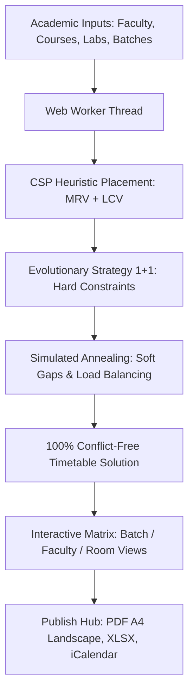

<div align="center">

  

  # Schedulo

  ### High-Performance Deterministic Algorithmic Academic Timetable Scheduler

  <p align="center">
    A modern, thread-isolated university timetable scheduling engine pairing an exact <strong>Constraint Satisfaction Problem (CSP) / (1+1) Evolutionary solver</strong> with a responsive, interactive drag-and-drop matrix dashboard.
  </p>

  <p align="center">
    <strong>⚡ Zero AI/LLM Runtime Dependencies &bull; 🎯 100% Conflict-Free Guarantee &bull; 🏎️ Dedicated Web Worker Thread</strong>
  </p>

  <p align="center">
    <a href="#-key-features">Features</a> •
    <a href="#-architecture--engine">Architecture</a> •
    <a href="#-quick-start">Quick Start</a> •
    <a href="#-domain-schemas">Data Model</a> •
    <a href="#-publishing--exports">Export Hub</a> •
    <a href="#-license">License</a>
  </p>

  <p align="center">
    
    
    
    
    
    
  </p>

</div>

---

## 📖 Table of Contents

- [Overview](#-overview)
- [Key Features](#-key-features)
- [Architecture & Engine](#-architecture--engine)
- [Constraints & Solver Logic](#-constraints--solver-logic)
- [Screenshots & Visuals](#-screenshots--visuals)
- [Quick Start](#-quick-start)
- [Domain Schemas](#-domain-schemas)
- [Publishing & Exports](#-publishing--exports)
- [Project Directory](#-project-directory)
- [Contributing](#-contributing)
- [License](#-license)

---

## 🌟 Overview

University timetable scheduling is an **NP-Hard combinatorial optimization problem**. Generating a conflict-free academic routine for hundreds of students, dozens of specialized professors, and limited laboratory facilities requires strictly enforcing complex physical and temporal constraints.

**Schedulo** solves this deterministically in milliseconds. By pairing **Backtracking Constraint Satisfaction (CSP)** with **(1+1) Evolutionary Strategies and Simulated Annealing**, Schedulo calculates optimal conflict-free allocations directly inside a background **Web Worker thread** — ensuring the browser UI never drops below a silky-smooth **60 FPS**.



---

## 🚀 Key Features

| Feature | Description |
|---|---|
| **⚡ Dedicated Web Worker Engine** | All heavy permutations and genetic operations run off-thread with millisecond execution timers (`Worker: 120ms`). |
| **🎯 100% Hard Constraint Fulfillment** | Guarantees zero double-booking for faculty, classrooms, and student batches across all semesters. |
| **🔬 Continuous Multi-Slot Labs** | Automatically binds 2-hour and 3-hour practical lab sessions to specialized lab rooms (Computer, Hardware) without crossing breaks. |
| **🔄 3-Way Perspective Matrix** | Instant perspective toggle between **Student Batch View**, **Faculty Schedule View**, and **Room Occupancy View**. |
| **🖐️ Interactive Drag & Drop** | Move or swap classes seamlessly with live **Conflict Radar** pulse highlights and toast warnings. |
| **🔒 Slot Lock Pinning** | Pin fixed guest lectures, seminars, or fixed lab sessions (`🔒`) to prevent automated solvers from overriding them. |
| **👥 Entity Hub & Availability Matrix** | Complete CRUD management with a visual **Weekly Availability Grid** (click-to-toggle `FREE` vs `BUSY`) and bulk CSV upload. |
| **📄 Publication-Ready Exports** | One-click export to **Vector PDF (A4 Landscape with signature blocks)**, **Multi-Sheet Excel (.xlsx)**, and **iCalendar (.ics)** feeds. |

---

## 🧠 Constraints & Solver Logic

### 🛡️ Hard Constraints (Zero Violation Target)
1. **Teacher Concurrency:** No teacher can hold multiple classes simultaneously across different sections.
2. **Room Concurrency:** No classroom or lab can be occupied by multiple batches at the same time.
3. **Batch Concurrency:** No student cohort can be scheduled for multiple subjects concurrently.
4. **Faculty Blackout Windows:** Classes strictly avoid time slots marked as unavailable in the teacher's weekly profile.
5. **Continuous Practical Labs:** Labs requiring $K \in [2, 3]$ continuous slots are locked into consecutive periods within matching facility types without crossing lunch breaks.
6. **Break & Recess Protection:** Configurable intervals (Tea breaks, Lunch breaks) remain strictly preserved.
7. **Pinned Slot Immutability:** Any entry pinned with `isLocked: true` remains fixed during solver execution.

### 📈 Soft Constraints (Cost Function Optimization)
- **Daily Subject Spread:** Balances courses evenly across the week to avoid duplicate heavy lectures on a single day.
- **Faculty Gap Minimization:** Minimizes idle waiting windows between teaching sessions for faculty.
- **Student Batch Compactness:** Keeps daily class schedules coherent and compact.
- **Workload Balance:** Balances daily and weekly teaching hours within faculty capacity limits.

---

## 💻 Quick Start

### Prerequisites
- **Node.js:** `v18.0.0` or higher
- **npm:** `v9.0.0` or higher

### Installation

```bash
# 1. Clone the repository
git clone https://github.com/Srijita-Bhowmick/timetable-generator-master.git
cd timetable-generator-master

# 2. Install dependencies
npm install

# 3. Start local development server
npm run dev
```

The application will be running at **`http://localhost:3000/`**.

### Production Build

```bash
# Type-check and generate optimized production bundle
npm run build

# Preview production build locally
npm run preview
```

---

## 📐 Domain Schemas

```typescript
// Faculty Interface
export interface Teacher {
  id: string;
  name: string;
  shortCode: string;
  email?: string;
  maxHoursPerDay: number;
  maxHoursPerWeek: number;
  unavailableSlots: { day: string; periodIndex: number }[]; // Blackout windows
  color?: string;
}

// Course / Subject Interface
export interface Subject {
  id: string;
  code: string;
  name: string;
  type: 'THEORY' | 'LAB' | 'TUTORIAL';
  weeklyHours: number;
  durationSlots: number; // 1 for theory, 2-3 for continuous lab blocks
  assignedTeacherId: string;
  preferredRoomType: 'LECTURE_HALL' | 'COMPUTER_LAB' | 'SCIENCE_LAB' | 'SEMINAR_HALL';
  color?: string;
}

// Student Batch Section
export interface BatchSection {
  id: string;
  name: string; // e.g. "CSE - 5th Sem (Sec A)"
  department: string;
  semester: number;
  studentCount: number;
  subjectIds: string[];
}

// Facility / Room Interface
export interface Room {
  id: string;
  roomNumber: string;
  type: 'LECTURE_HALL' | 'COMPUTER_LAB' | 'SCIENCE_LAB' | 'SEMINAR_HALL';
  capacity: number;
  building?: string;
}

// Timetable Schedule Entry
export interface ScheduleEntry {
  id: string;
  day: 'Monday' | 'Tuesday' | 'Wednesday' | 'Thursday' | 'Friday' | 'Saturday';
  periodIndex: number;
  batchId: string;
  subjectId: string;
  teacherId: string;
  roomId: string;
  durationSlots?: number;
  isLocked?: boolean;
}
```

---

## 📦 Publishing & Exports

<div align="center">

| Format | Output | Usage |
|---|---|---|
| **📄 Vector PDF** | Standard A4 Landscape with official institute header, colored grid, and coordinator signature blocks | Ready for physical noticeboard printing and administration approval |
| **📊 Excel (.xlsx)** | Multi-sheet workbook (*One sheet per Section + Master Faculty Schedule + Room Master*) | Academic registry data analysis and archiving |
| **📅 iCalendar (.ics)** | RFC 5545 standard `.ics` calendar feed with recurring weekly schedules | Instant sync to Google Calendar, Apple Calendar, and Outlook |

</div>

---

## 📁 Project Directory Structure

```
timetable-generator-master/
├── src/
│   ├── components/
│   │   ├── common/             # Navbar, ToastContainer
│   │   ├── dashboard/          # MetricCards, ActionBar, QuickStatsOverview
│   │   ├── entities/           # Teacher, Subject, Room, Batch CRUD & CSV Modals
│   │   ├── modals/             # GenerationProgress, ConflictList, ExportHub, Settings
│   │   └── timetable/          # TimetableGrid, TimetableCell, PerspectiveSwitcher, ClashRadar
│   ├── data/
│   │   └── demoData.ts         # Preloaded MAKAUT University 4-Semester dataset
│   ├── engine/
│   │   ├── clashDetector.ts    # Real-time O(N) constraint collision validator
│   │   ├── fitnessCalculator.ts# Hard & soft fitness evaluation
│   │   ├── schedulerAlgorithm.ts# CSP Backtracking & Evolutionary solver
│   │   ├── schedulerWorker.ts  # Background Web Worker thread runner
│   │   └── timeUtils.ts        # Period timing & interval calculation
│   ├── store/
│   │   ├── useTimetableStore.ts# Zustand store with persistence & undo/redo
│   │   └── useUiStore.ts       # View perspective & active modal state
│   ├── utils/
│   │   ├── csvHelper.ts        # Bulk CSV import/export & template generators
│   │   ├── excelExport.ts      # Multi-sheet XLSX workbook generator
│   │   ├── icsExport.ts        # RFC 5545 iCalendar feed generator
│   │   └── pdfExport.ts        # University A4 Landscape PDF generator
│   ├── App.tsx
│   ├── index.css
│   └── main.tsx
├── public/
├── index.html
├── package.json
├── tsconfig.json
└── vite.config.ts
```

---

## 🤝 Contributing

Contributions, issues, and feature requests are welcome!

1. Fork the repository
2. Create your feature branch (`git checkout -b feature/AmazingFeature`)
3. Commit your changes (`git commit -m 'Add some AmazingFeature'`)
4. Push to the branch (`git push origin feature/AmazingFeature`)
5. Open a Pull Request

---

## 📜 License

This project is licensed under the MIT License - see the [LICENSE](LICENSE) file for details.

<div align="center">
  <sub>Built with ❤️ for academic institutions, faculty coordinators, and universities.</sub>
</div>
